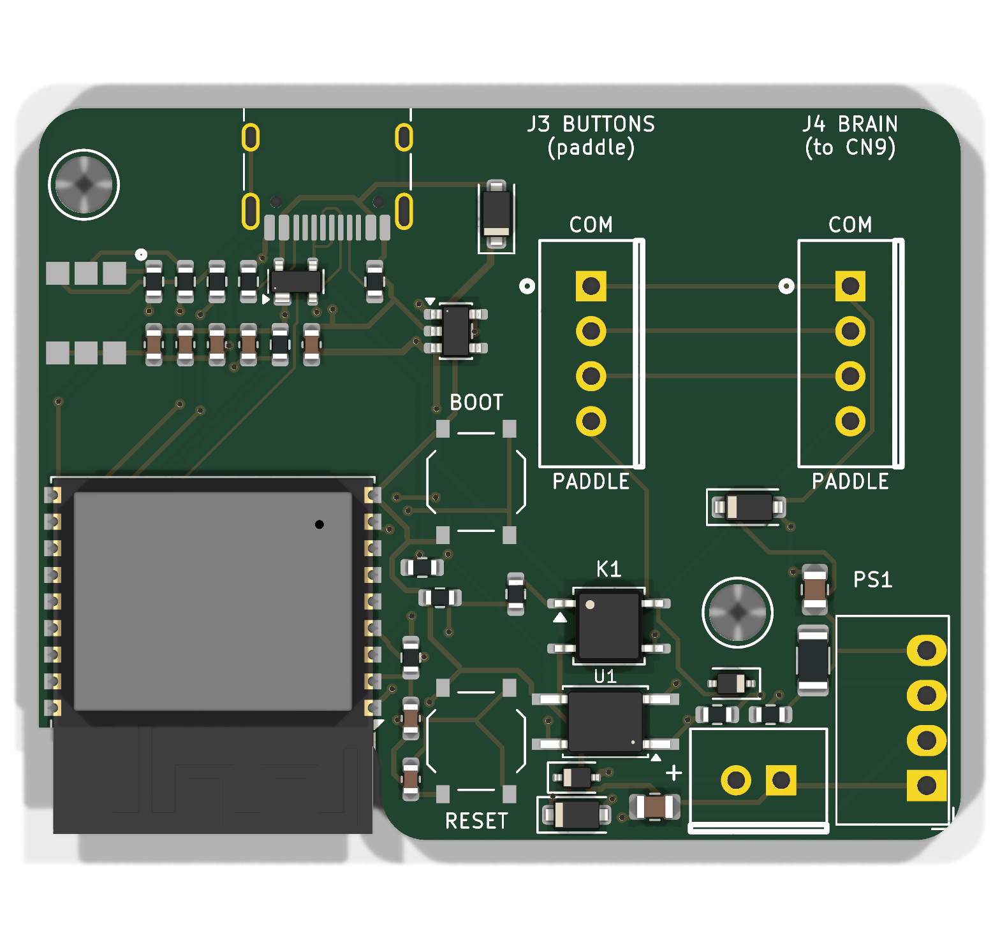
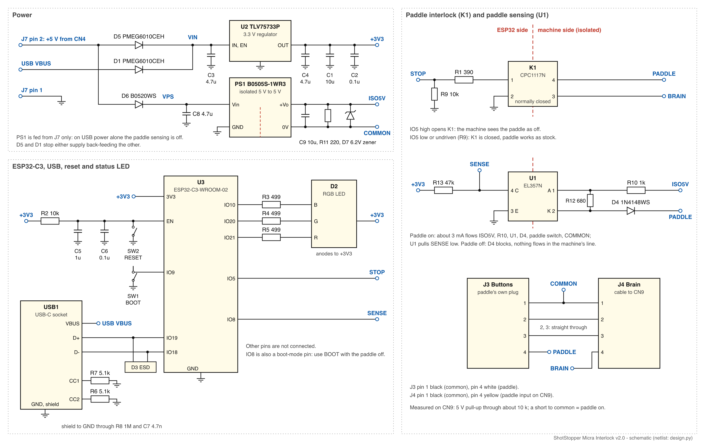

# ShotStopper Micra Interlock

A replacement for the ShotStopper V3.1 board that gives a La Marzocco Linea
Micra Linea Mini-style brew-by-weight:

- Paddle **on**: the shot starts, and the scale tares and starts its timer.
- Target weight reached: the shot **stops even though the paddle is still on**.
- Paddle **off** at any time: the shot stops, as on a stock machine.
- After an automatic stop, the next shot needs the paddle turned off and on again.
- If the board is unpowered, unplugged from the scale, or crashed, the paddle
  works exactly like a stock Micra.

Status: **design only.** The board has not been built and the firmware has
not run on hardware. Work through [Before you order](#before-you-order) first.



## Same as V3.1

- **Outline and mounting holes**, so it fits the V3.1 case and the same spot in
  the machine.
- **The ESP32-C3 section** at V3.1's pad positions: ESP32-C3-WROOM-02 module
  (antenna over the cut-out), USB-C for power and flashing, BOOT and RESET
  buttons, and the same RGB LED (MEIHUA MHP5050RGBDT) on the same pins (red
  GPIO21, green GPIO20, blue GPIO10), so the indicator colours are unchanged.
- **The connectors and cables.** J3 and J4 are 4-pin headers in the same holes
  V3.1 uses for the Micra (the middle four of the 2x8 pattern's even row, ribbon
  pins 6, 8, 10, 12). The install is the same unplug/plug:
  - **J3 "Buttons"**: the Micra's own paddle plug.
  - **J4 "Brain"**: the black/yellow cable to **CN9** on the control board.
  - **J7 "PWR"**: the red/black cable from **CN4** (+5 V). J7 is turned 90°
    compared with V3.1's power header: pins side by side, + on the left, latch
    wall toward the board edge.

  Pin 1 (square pad) is common, the black wire; pin 4 is the paddle line.
  Pins 2 and 3 (CN9 keys the Micra doesn't use) pass straight through.

Removed from V3.1: the Q1 optocoupler ("induce" and "detect"), the SB1–SB5
jumpers, the spade terminals and the reed-switch header. There is no remote
start.

## How it works

Full schematic: [schematic.svg](schematic.svg) (drawn by `schematic.py`; the
netlist itself is in `design.py`).



```
 J3 pin 4 (paddle) ── PADDLE ───[ K1 normally-closed ]─── BRAIN ── J4 pin 4 (to CN9)
                        │
                        └──|<── D4 ── U1 LED ── R10 ── ISO 5V ┐
                                     (R12 across LED)          PS1 isolated DC-DC
 J3/J4 pin 1 (COMMON) ────────────────────────────── ISO 0V ┘   5 V → 5 V
                                                                    (R11 min load)
 GPIO5 ── R1 ── K1 LED            HIGH = K1 open = machine sees paddle off
       └─ R9 10k to GND           keeps K1 closed during boot / reset
 GPIO8 ── U1 transistor to GND    LOW = paddle on  (R13 47k pull-up)
```

- **K1** (CPC1117N) is a normally-closed solid-state switch in series with the
  paddle line. Driving GPIO5 high opens it, so the control board sees the paddle
  as off and stops the shot. With no drive, it is closed.
- **U1** senses the paddle independently of K1. A small isolated 5 V supply
  (PS1) pushes about 1.5 mA through U1's LED and D4 into the paddle wire. When
  the paddle shorts that wire to COMMON, U1 conducts and pulls GPIO8 low. This
  works with K1 open or closed, so the firmware always knows where the paddle is.
- **D4** stops the control board's own pull-up from feeding back into the sense
  circuit. **R12** (680 Ω, smaller than R10) soaks up the leakage when the
  control board's pull-up is about 3.3 V, so a floating line doesn't read as
  "paddle on".
- **R11** (220 Ω, 1206) draws about 21 mA so that PS1 has its 10 % minimum load. With
  less, its output is unspecified and can rise well above 5 V.
- The ESP32 side and the machine side share no copper. They connect only
  through K1, U1 and PS1. The minimum copper gap between the two sides is
  0.8 mm (between PS1's own pins). That is **functional isolation for a
  low-voltage paddle line, not mains-rated isolation.**
- Power: 5 V from CN4 comes in through D5 and USB 5 V through D1, so neither
  source back-feeds the other and a reversed J7 does no damage. That shared
  rail (about 4.6 V) feeds the 3.3 V regulator (U2).
- PS1 (B0505S-1WR3, 5 V in, 5 V out) is fed from J7 only, through D6. **On USB
  power alone the paddle sensing is off**, so the board can never drive the
  control board's paddle input while the machine is off. PS1 is not on the
  3.3 V rail, which keeps its load, and heat, off the small regulator.
- **D7** (6.2 V zener) clamps the isolated rail in case PS1 ever runs unloaded.

### What the machine's control board sees

- Paddle off: the sense circuit is behind D4, which is reverse-biased by the
  control board's own 5 V pull-up, so nothing flows into or out of the paddle
  input. The isolated rail (4.6–5.5 V, 6.5 V at most with D7) minus D4's drop
  stays at or below the control board's 5 V.
- Paddle on: the sense current (about 3 mA) flows from PS1 through the paddle
  switch and back to PS1 on this board. None of it flows in the CN9 cable.
- K1 adds at most 16 Ω in series (8 mV at the measured 0.5 mA) when closed and
  about 1 µA of leakage when open.
- Board unpowered or J7 unplugged: PS1 is off, D4 blocks, K1 is closed. The
  paddle line is as on a stock machine.
- Extra load on CN4: PS1 draws roughly 60 mA from the machine's 5 V, on top of
  the ESP32's draw that V3.1 already has.

GPIO8 is V3.1's "IN" pin. V3.1's "OUT" (GPIO6, remote start) is not connected.

GPIO8 is also an ESP32-C3 boot-mode pin: to enter the bootloader with the BOOT
button, have the paddle **off**. Normal start-up is not affected.

## Firmware

Build and flash with PlatformIO from the repo root: `pio run -t upload` (the
`micra` environment sets `MOMENTARY false` and `PADDLE_INTERLOCK true` for the
ESP32-C3). In the Arduino IDE, set those two in
`examples/shotStopper/shotStopper.ino` and pick an ESP32-C3 board with
"USB CDC On Boot" enabled.

What the firmware does in this mode:

| Event | Result |
|-------|--------|
| Paddle on | Machine brews; the shot is tracked: tare, reset and start the timer |
| Predicted target weight, or `MAX_SHOT_DURATION_S` | GPIO5 high: K1 opens and the shot stops |
| Paddle still on after the stop | K1 stays open; no new shot |
| Paddle off (50 ms debounce, `PADDLE_DEBOUNCE_MS`) | GPIO5 low: K1 closes, so the next paddle-on always brews |
| Paddle off before the target | Shot stops; K1 never opens |
| Scale lost during a weighed shot | GPIO5 high: the shot stops (`STOP_ON_SCALE_LOSS`; set it `false` to leave the shot to the paddle) |
| Scale not connected when the paddle goes on | K1 stays closed; the paddle works by hand |
| Paddle on for `INTERLOCK_MAX_BREW_S` (90 s), with or without a scale | GPIO5 high: the brew stops until the paddle is off |
| Reconnect, or reset, partway through a shot | The shot keeps running on the paddle and isn't re-tared |
| Crash or watchdog reset during a held stop | K1 closes for the fraction of a second the ESP32 takes to restart (the machine may click on briefly), then the stop is held again until the paddle is off |
| `loop()` stalls for 20 s (`WATCHDOG_S`) | The watchdog resets the board, and K1 closes |

### Fail-safe guarantees

- **Paddle off always stops brewing.** This is enforced by hardware: K1 is in
  series, so an open paddle opens the line whatever the ESP32 does.
- **Board unpowered, unplugged, or held in reset.** K1 is normally closed, and R9
  keeps it closed while GPIO5 is undriven, so the Micra behaves as stock.
- **Paddle on starts brewing** whenever the firmware is running, or the board is
  off or resetting. The only time it doesn't is an automatic stop being held,
  and that hold ends as soon as the paddle reads off. A hung ESP32 is reset by
  the watchdog within `WATCHDOG_S`.
- **No remote start.** The ESP32 can only interrupt the paddle line. It cannot
  make the machine brew.

These cases are covered by host tests with stub libraries, not on hardware.

Flow rate, the scale sanity checks and over-the-air updates are described
in [`examples/shotStopper/README.md`](../../examples/shotStopper/README.md).

## Ordering from PCBWay

Everything is in `fab/`:

| File | Upload as |
|------|-----------|
| `shotstopper-micra-interlock-gerbers.zip` | PCB Gerber files (includes drill files) |
| `bom.csv` | Assembly BOM (manufacturer part numbers) |
| `centroid.csv` | Pick-and-place / centroid file (mm, top side) |

PCB options: 2 layers, 51.9 × 41.3 mm, 1.6 mm FR-4, 1 oz copper, any
solder-mask colour, lead-free HASL or ENIG. Minimum track 0.15 mm (the USB-C
signals only; 0.25 mm elsewhere), minimum gap 0.2 mm, smallest drill 0.3 mm
(vias), all inside PCBWay's standard capability.

Assembly: top side only, SMD plus four through-hole parts (the J3, J4, J7
headers and PS1).

## Before you order

1. **Headers.** J3 and J4 are TE AMPMODU MOD II 280371-1 (4-pin) and J7 is
   280370-1 (2-pin): 2.54 mm, partially shrouded, with a latch window. The
   V3.1 seller's cable plugs are the matching MOD II housings (280359 4-pin,
   280358 2-pin), and the listed header bodies (12.7 x 5 mm, 7.7 x 5 mm) match
   those measured on V3.1. Per AMP drawing C-280370 the body is 5.0 mm wide
   and 12.6 mm tall, with the pin row 2.2 mm from one face and 2.8 mm from the
   other; the 5.8 mm outlines on the board cover either way round, and J7
   clears R10/R12 and the board edge by at least 0.4 mm in both cases. The
   latch wall goes on the side with the thick silkscreen bar: with the USB
   connector up, on the right for J3 and J4 (as on V3.1) and toward the board
   edge for J7, which is turned 90 degrees. A reversed J7 swaps + and -: red
   goes to the pin marked +.
2. **Paddle line: measured.** On the CN9 cable the control board pulls the
   paddle line up to 5 V DC through about 10 k (5.0 V open, 2.52 V across
   10 k, no AC), so about 0.5 mA flows with the paddle on. The machine does not
   brew at 2.52 V. No change to K1, U1, R10 or R12 was needed.
3. **Clearance.** PS1 is about 10 mm tall (bottom right). The V3.1 case is open
   on top, so this should be fine; check anyway.
4. **First power-up on the bench.** With only USB connected: the LED lights;
   GPIO5 high makes K1 open (measure the resistance between J3 pin 4 and J4
   pin 4). Paddle sensing needs 5 V on J7: with a 5 V supply there, J4 pin 4
   must read between 0 and +5 V relative to pin 1 (never negative, never above
   5.5 V), and shorting J3 pin 4 to pin 1 pulls GPIO8 low. A negative reading
   means a header is in backwards: do not connect it to the machine. Measure across C9 as
   well: expect about 4.6–5.5 V from PS1.

Work inside the Micra only with it unplugged. Mains is present in the chassis.

## Regenerating the board

`design.py` is the source of truth: parts, positions, nets, and the
logic/machine routing areas.

```bash
./make_all.sh /path/to/python-with-numpy-scipy-pillow
```

The script runs `build_board.py` (KiCad Python: places the parts),
`route.py` (a small two-layer router that keeps each net on its own side),
`finish_board.py` (adds tracks, the ground pour and silkscreen), `set_rules.py`
(design rules), KiCad DRC, and the
Gerber/drill/BOM/centroid exports. It needs KiCad 10. You can open
`shotstopper-micra-interlock.kicad_pcb` in KiCad and edit it by hand, but a
rerun of the script overwrites it.

There is no schematic file. The netlist is in `design.py` (`NETS`).

Based on ShotStopper V3.1 by Tate Mazer (MIT License).
