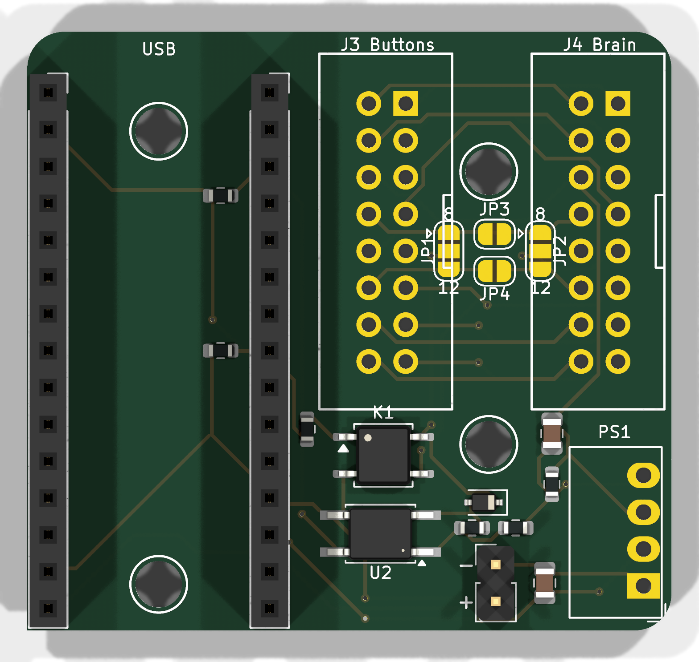

# ShotStopper Micra Interlock

A replacement for the ShotStopper V2.1 board, designed to give a La Marzocco
Linea Micra Linea Mini-style brew-by-weight:

- Paddle **on**: the shot starts, and the scale tares and starts its timer.
- Target weight reached: the shot **stops even though the paddle is still on**.
- Paddle **off** at any time: the shot stops, as on a stock machine.
- After an automatic stop, the next shot needs the paddle turned off and on again.
- If the board is unpowered, unplugged from the scale, or crashed, the paddle
  works exactly like a stock Micra.

Status: **design only.** The board has not been built and the firmware has
not run on hardware. Work through [Before you order](#before-you-order) first.



## Same as V2.1

The outline, the four M3 mounting holes, the Arduino Nano ESP32 socket, the
two 2x8 ribbon headers (J3 "Buttons", J4 "Brain") and the 2-pin power header
are all where they are on V2.1, so the board fits the V2.1 half case and the
same place in the machine.

Removed from V2.1: the spade terminals, the reed-switch header, and the Q1
optocoupler circuit. D9 and D11 are no longer connected.

## How it works

```
 J3 paddle pin ──JP1── PADDLE ───[ K1 normally-closed ]─── BRAIN ──JP2── J4 paddle pin
                         │                                             (to control board)
                         └──|<── D1 ── U2 LED ── R3 ── ISO 5V ┐
                                      (R6 across LED)          PS1 isolated DC-DC
 J3/J4 pin 6 (COMMON) ─────────────────────────────── ISO 0V ┘   3.3 V → 5 V
                                                                     (R4 min load)
 Nano D5  ── R1 ── K1 LED            HIGH = K1 open = machine sees paddle off
          └─ R2 10k to GND           keeps K1 closed during boot / reset
 Nano D10 ── U2 transistor to GND    LOW = paddle on  (R7 10k pull-up)
```

- **K1** (CPC1117N) is a normally-closed solid-state switch in series with the
  paddle line. Driving D5 high opens it, so the control board sees the paddle
  as off and stops the shot. With no drive, it is closed.
- **U2** senses the paddle independently of K1. A small isolated 5 V supply
  (PS1) pushes about 1.4 mA through U2's LED and D1 into the paddle wire. When
  the paddle shorts that wire to COMMON, U2 conducts and pulls D10 low. This
  works with K1 open or closed, so the firmware always knows where the paddle is.
- **D1** stops the control board's own pull-up from feeding back into the sense
  circuit. **R6** soaks up the small leakage when the control board's pull-up
  is about 3.3 V, so a floating line doesn't read as "paddle on".
- The logic side (Nano) and the machine side (ribbon) share no copper. They
  connect only through K1, U2 and PS1. The minimum copper gap between the two
  sides is 0.7 mm. That is **functional isolation for a low-voltage paddle
  line, not mains-rated isolation.**

D10 has the same meaning as V2.1's "In", so the sensing is compatible.
V2.1's parallel "Out" (D11) is not on this board. The old latching mode
(`MOMENTARY false`, `PADDLE_INTERLOCK false`) still runs, but it can no longer
keep a shot going after the paddle is turned off.

## Setting the jumpers (one time, before installing)

V2.1 carried the paddle signal on ribbon pin **8** or pin **12**, depending on
the machine (its SB1–SB5 jumpers). Find out which pin yours uses, either from
your V2.1 board (which of SB1/SB2 is bridged) or with a meter. Then bridge
these with a blob of solder:

| Paddle on | JP1 (paddle side) | JP2 (brain side) | Also bridge |
|-----------|-------------------|------------------|-------------|
| pin 8     | centre to **8**   | centre to **8**  | JP4 (pin 12 straight through) |
| pin 12    | centre to **12**  | centre to **12** | JP3 (pin 8 straight through) |

The "8" and "12" marks are printed at the ends of JP1 and JP2. All other
ribbon pins pass straight through, and pin 6 is COMMON, as on V2.1.

## Firmware

In `examples/shotStopper/shotStopper.ino` set:

```c
#define MOMENTARY false
#define PADDLE_INTERLOCK true
```

What the firmware does in this mode:

| Event | Result |
|-------|--------|
| Paddle on | Shot starts: tare, reset and start the timer |
| Predicted target weight, or `MAX_SHOT_DURATION_S` | D5 high: K1 opens and the shot stops |
| Paddle still on after the stop | K1 stays open; no new shot |
| Paddle off for 300 ms (`PADDLE_RELEASE_MS`) | D5 low: K1 closes, ready for the next shot |
| Paddle off before the target | Shot ends normally; K1 never opens |
| Scale disconnects mid-shot | K1 stays closed; the paddle works by hand |
| Board boots with the paddle on | K1 opens until the paddle is turned off |

These cases are covered by host tests with stub libraries, not on hardware.

## Ordering from PCBWay

Everything is in `fab/`:

| File | Upload as |
|------|-----------|
| `shotstopper-micra-interlock-gerbers.zip` | PCB Gerber files (includes drill files) |
| `bom.csv` | Assembly BOM (manufacturer part numbers) |
| `centroid.csv` | Pick-and-place / centroid file (mm, top side) |

PCB options: 2 layers, 44.3 × 41.3 mm, 1.6 mm FR-4, 1 oz copper, any
solder-mask colour, lead-free HASL or ENIG. Minimum track and gap are
0.25 mm and 0.2 mm, and the smallest drill is 0.3 mm (vias), all inside
PCBWay's standard capability.

Assembly: top side only, SMD and through-hole. The Arduino Nano ESP32 is not
on the BOM; it plugs into the J1/J2 sockets. JP1–JP4 are bare pads with no
part to place.

## Before you order

1. **Paddle line voltage and current.** With the machine on, measure DC volts
   between the paddle ribbon wire and pin 6 (COMMON), with the paddle off; expect
   3.3–5 V. Then measure the current with the paddle on; expect a few mA. K1 is
   rated 60 V / 120 mA. The line must not be mains.
2. **Which ribbon pin** carries the paddle (8 or 12). See the jumper table above.
3. **PS1 pinout.** The footprint assumes the industry-standard SIP-4 (1 = Vin−,
   2 = Vin+, 3 = Vout−, 4 = Vout+), which Mornsun B0305S-1WR3 and Murata MEE1S0305SC
   both use. Check it against the current datasheet.
4. **Clearance.** PS1 is about 10 mm tall and sits beside J4 (bottom right).
   Check that it clears whatever is above the board in your machine.
5. **First power-up on the bench.** With only USB connected, check that D5 high
   makes K1 open: measure the resistance between J3 and J4 on the selected pin.
   Then check that shorting the selected J3 pin to pin 6 pulls D10 low.

Work inside the Micra only with it unplugged. Mains is present in the chassis.

## Regenerating the board

`design.py` is the source of truth: parts, positions, nets, and the
logic/machine routing areas.

```bash
./make_all.sh /path/to/python-with-numpy-scipy-pillow
```

The script runs `build_board.py` (KiCad Python: places the parts),
`route.py` (a small two-layer router that keeps each net on its own side),
`finish_board.py` (adds tracks and silkscreen), KiCad DRC, and the
Gerber/drill/BOM/centroid exports. It needs KiCad 10. You can open
`shotstopper-micra-interlock.kicad_pcb` in KiCad and edit it by hand, but a
rerun of the script overwrites it.

There is no schematic file. The netlist is in `design.py` (`NETS`).

Based on ShotStopper V2.1 by Tate Mazer (MIT License).
